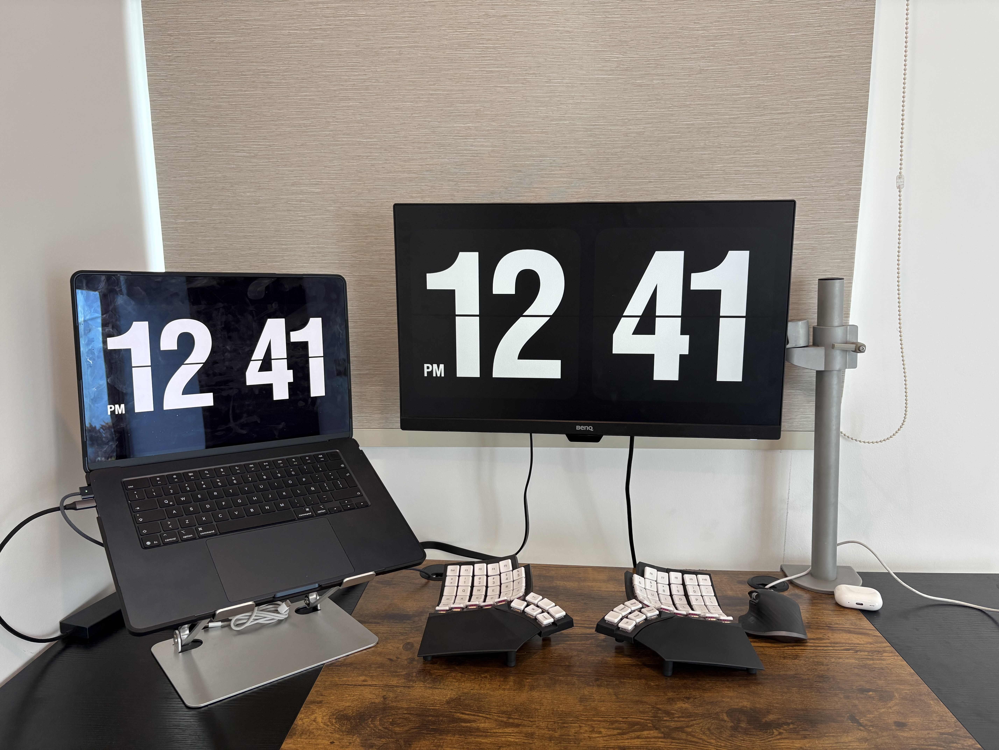

# My Mac Setup

My development environment, optimized for speed and low-friction interaction.
Keyboard-driven everything. Muscle memory over menus.

**Last Updated**: 2026-02-08



---

## Hardware

| Component | Model |
| :--- | :--- |
| **Laptop** | MacBook Air M4 (15", 16 GB RAM, 512 GB SSD) |
| **Keyboard** | MoErgo Glove80 |
| **Mouse** | Logitech MX Master 3 |
| **Displays** | ASUS TUF Gaming VG27WQ3B (27" 1440p 180Hz) + BenQ GW2480 + MacBook |
| **Audio** | Ugreen Headphones |
| **Ergonomics** | Standing Desk, Herman Miller Aeron B |

---

## Software

**Terminal Stack**: Alacritty + tmux + Neovim (NvChad) + Claude Code + Codex

**Core Apps**: Arc, Raycast, Spotify

**System Tools**: Aerospace (tiling WM), Karabiner Elements, CleanshotX, Monologue, MonitorControl, Bartender, Supercharge, Cold Turkey

**CLI Power Tools**: bat, eza, fd, fzf, ripgrep, lazygit, delta, zoxide, yazi, bottom, dust, hyperfine

**Browser Extensions**: Vimium C, Hotkey Router, Video Speed Controller, Untrap for YouTube, Cold Turkey Blocker

**Raycast Extensions**: Spotify Player, CleanShot X, Aerospace, Arc, Notion, Gmail, Calendar, Pomodoro, Port Manager, System Monitor, Iconify, Paste as Plain Text, Remove Paywall, Remove Background (sips), CoinGecko, Fetch YouTube Transcript (custom), Fast WhatsApp (custom)

---

## Custom Projects

| Project | Description |
| :--- | :--- |
| [primeX](https://github.com/diegooprime/primeX) | Twitter client with vim-navigation, no distractions |
| [primeyt](https://github.com/diegooprime/primeyt) | YouTube client with vim-like navigation, no distractions |
| [fastytranscript](https://github.com/diegooprime/fastytranscript) | Raycast extension for instant YouTube transcripts |
| [fastwhatsapp](https://github.com/diegooprime/fastwhatsapp) | Raycast extension for fast WhatsApp messages |
| [hotkey_extension](https://github.com/diegooprime/hotkey_extension) | Chrome extension for unified hotkeys across AI chat sites |
| [task_log](https://github.com/diegooprime/task_log) | Minimal floating task manager with vim keybindings |

---

## Repo Structure

Stow-compatible layout -- each directory mirrors `~/.config/` so you can symlink with `stow <package>`.

```
.
├── Brewfile                        # brew bundle
├── setup.sh                        # bootstrap script (brew + stow)
├── aerospace/.config/aerospace/    # tiling window manager
├── alacritty/.config/alacritty/    # terminal emulator
├── tmux/.config/tmux/              # multiplexer + custom scripts
├── nvim/.config/nvim/              # NvChad + lazy.nvim
├── karabiner/.config/karabiner/    # keyboard remapping
├── git/.config/git/                # git + delta config
├── extras/                         # Raycast + Vimium C (manual import)
└── assets/                         # images + keyboard layout firmware
```

### Quick Start

```bash
git clone https://github.com/diegooprime/mac-setup.git
cd mac-setup
chmod +x setup.sh
./setup.sh
```

---

## Keybindings

`Hyper` = `Caps Lock` (remapped via Karabiner to Ctrl+Shift+Option+Cmd)

### Window Management (Aerospace)

| Hotkey | Action |
| :--- | :--- |
| `Hyper + Space` | Focus next monitor |
| `Hyper + Tab` | Move window to next monitor |
| `Hyper + ;` | Toggle fullscreen |
| `Hyper + 1/2/C/6/7/8/0/N` | Switch to workspace 1-8 |
| `Hyper + -` | Cycle workspaces |
| `Hyper + U` | Vertical tile layout |
| `Hyper + Z` | Horizontal tile layout |

### Navigation (Karabiner)

| Hotkey | Action |
| :--- | :--- |
| `Hyper + H/J/K/L` | Vim navigation in Alacritty (Ctrl+hjkl for tmux/vim panes) |
| `Hyper + M` | Cycle browser tabs (Ctrl+Tab) |
| `Hyper + K` | Cycle applications (Cmd+Tab) |
| `Hyper + D` | Monologue (Ctrl+Shift+K) |
| `Hyper + Down/Up` | Left/Right arrow |
| `F1/F2` | Volume (tap) / Brightness (with Hyper) |
| `F19` | Hyper modifier (Glove80) |
| `F20` | Tmux prefix (Ctrl+Space) |

### Tmux (prefix: `Ctrl+Space`)

| Key | Action |
| :--- | :--- |
| `n` | New window |
| `t` | New named session |
| `e` | Rename window |
| `m` | Next session |
| `Tab` | Next window |
| `1-9, 0` | Select window 1-10 |
| `Space` | Next pane |
| `b / g` | Split vertical / horizontal |
| `h/j/k/l` | Resize pane |
| `w` | Kill pane |
| `q` | Kill window |
| `x` | Kill session |
| `j` | Copy last Claude Code code block |
| `k` | Code block picker (fzf popup) |
| `Alt+D / Alt+V` | Copy last output block |
| `Alt+Y / Alt+E` | Copy visible pane |

### Neovim

| Key | Action |
| :--- | :--- |
| `;` | Enter command mode |
| `jk` | Escape (insert mode) |
| `<leader>cp` | Copy current file path |
| `<leader>cf` | Copy entire file |
| `<leader>lg` | LazyGit |

### Vimium C (Arc browser)

| Key | Action |
| :--- | :--- |
| `e` | Link hints |
| `E` | Open link in new tab |
| `r` | Focus input |
| `H / L` | Back / Forward |

---

## Theme

**Catppuccin Mocha** everywhere -- terminal, tmux status bar, git delta, NvChad (onedark variant).

**Font**: JetBrainsMono Nerd Font (size 18)
